# Salud Para Salta y NOA

**Educación en salud pensada para personas mayores del Noroeste Argentino:** letra grande, botones amplios, ingreso con el rostro en lugar de contraseñas, clases en video, calculadora de IMC y orientación por síntomas con machine learning.

[](https://www.saludadultomayor.org)
[](LICENSE)


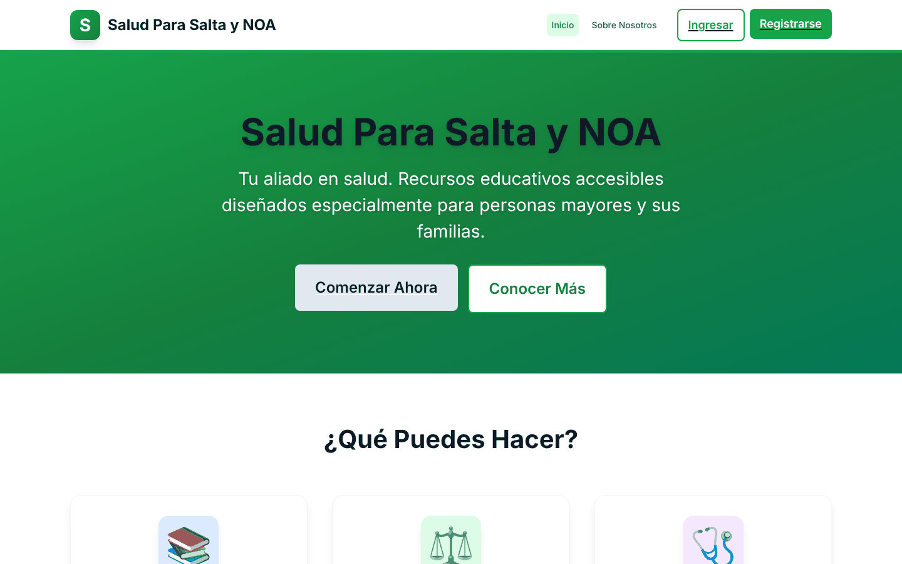

> [!IMPORTANT]
> La plataforma es **orientativa y educativa**. No da diagnósticos ni reemplaza la consulta con profesionales de la salud, y así lo dice en cada pantalla donde muestra resultados.

---

## Contenido

- [Qué es y para quién](#qué-es-y-para-quién)
- [Funcionalidades](#funcionalidades)
- [Capturas](#capturas)
- [Cómo funciona](#cómo-funciona)
- [Seguridad y privacidad](#seguridad-y-privacidad)
- [Stack](#stack)
- [Correr en local](#correr-en-local)
- [Despliegue](#despliegue)
- [Estado del proyecto](#estado-del-proyecto)
- [Autor](#autor)
- [Licencia](#licencia)

---

## Qué es y para quién

En Salta y el resto del NOA muchas personas mayores viven lejos de los centros de salud y tienen poca experiencia con la tecnología. Las aplicaciones de salud habituales les piden recordar contraseñas, leer letra pequeña y tocar botones diminutos. **Salud Para Salta y NOA** intenta sacar esas barreras del medio:

| Para quién | Qué encuentra |
|---|---|
| **Personas mayores y sus familias** | Clases en video sobre nutrición, ejercicio, salud cardiovascular, diabetes y salud mental; una calculadora de IMC que explica el resultado con recomendaciones; y una herramienta que orienta a partir de síntomas y siempre recomienda consultar a un médico. Para entrar solo necesitan su DNI/cédula y su rostro. |
| **Docentes y profesionales de la salud** | Un panel para publicar y administrar sus propias clases (video, PDF o artículo) y ver estadísticas por categoría. |
| **Administración** | Permisos para gestionar cualquier clase y a los usuarios a través de la API. |

El proyecto nació como **Trabajo Final Integrador** de la Licenciatura en Ciencia de Datos (UPATECO, 2025). El análisis académico completo, que trata la ética de datos, la accesibilidad y la estrategia de comunicación, está en [`TRABAJO_FINAL_INTEGRADOR_COMPLETO.md`](TRABAJO_FINAL_INTEGRADOR_COMPLETO.md).

---

## Funcionalidades

### Accesibilidad primero

El diseño parte de la idea de que la persona usuaria puede ver poco, tener poca precisión con el dedo o no conocer las convenciones de la web. Esto es lo que hace el código ([`globals.css`](frontend/src/app/globals.css), [`components/ui`](frontend/src/components/ui), [`Navbar.tsx`](frontend/src/components/layout/Navbar.tsx)):

- **Texto grande y aireado.** La letra base es de 18 px con interlineado de 1,75, y los títulos están en negrita sobre fondos claros.
- **Objetivos táctiles grandes.** Todo botón mide al menos 48 × 48 px, los botones principales 56 px de alto y los campos de formulario 56 px.
- **Foco siempre visible.** Hay un anillo de 4 px al navegar con teclado, y un enlace oculto **«Saltar al contenido principal»** aparece al pulsar Tab.
- **Semántica para lectores de pantalla.** El documento declara `lang="es"`, los landmarks llevan nombre (`role="navigation"` con `aria-label`), el enlace activo usa `aria-current` y el menú móvil `aria-expanded`. Los campos informan sus errores con `aria-invalid` y `aria-describedby`, las alertas usan `role="alert"`, los botones de carga `aria-busy` y los indicadores de espera `aria-live`.
- **Pensado primero para el celular.** El menú se colapsa en un botón grande y los formularios ocupan todo el ancho.
- **Lenguaje simple y avisos claros.** Cada herramienta de salud muestra que su resultado es orientativo.

### Ingreso biométrico: el rostro en lugar de la contraseña

- **Registro.** Después de completar el formulario se abre la cámara y una guía de 4 pasos: de frente, girando a la izquierda, girando a la derecha y sonriendo. En el navegador, [`@vladmandic/face-api`](https://github.com/vladmandic/face-api) (TinyFaceDetector y 68 puntos faciales) mide si el rostro está centrado, si tiene buen tamaño, si la detección es confiable y si hay buena iluminación, y **toma cada foto sola** cuando la calidad es suficiente. La persona no tiene que apretar ningún botón.
- **Ingreso de usuarios.** Basta con el número de cédula/DNI y el rostro. No hay contraseña que recordar: para los usuarios regulares, el frontend genera una contraseña aleatoria que nunca se muestra.
- **Ingreso de docentes.** Para entrar con el rostro también se pide la contraseña. Además pueden entrar solo con email y contraseña.
- **WebAuthn / FIDO2.** El backend tiene endpoints para registrar y usar llaves de acceso (huella o PIN del dispositivo) con [`@simplewebauthn/server`](https://simplewebauthn.dev/), y el frontend incluye el cliente en [`lib/webauthn.ts`](frontend/src/lib/webauthn.ts). La interfaz todavía no los ofrece (ver [Estado del proyecto](#estado-del-proyecto)).

### Roles

Los permisos se aplican en el backend con los middlewares `protect` (JWT) y `authorize(...roles)`. Así se reparten:

| Acción | usuario | docente | admin |
|---|:---:|:---:|:---:|
| Ver clases públicas, usar IMC y orientación por síntomas | ✅ | ✅ | ✅ |
| Editar el perfil, cambiar la contraseña y actualizar el rostro | ✅ | ✅ | ✅ |
| Crear clases y ver «Mis clases» y estadísticas | — | ✅ | ✅ |
| Editar o eliminar clases | — | solo las propias | todas |
| Listar o eliminar usuarios (`GET`/`DELETE /api/users`) | — | — | ✅ |

El registro público solo crea cuentas de **usuario** o **docente**. Un rol de administrador se asigna desde el servidor con `npx tsx src/scripts/updateUserRole.ts <email> admin`.

### Clases educativas

- Pueden ser de tipo **video, PDF o artículo**, con categoría, etiquetas, duración y visibilidad (pública o privada).
- Se pueden buscar por texto y filtrar por categoría. Cuando la clase es un video de YouTube, la **miniatura se genera sola**.
- [`seedClases.ts`](backend/src/scripts/seedClases.ts) carga 15 clases de ejemplo en 7 categorías: nutrición, salud mental, ejercicio físico, salud cardiovascular, diabetes, salud ósea y prevención.

### Calculadora de IMC

Recibe el peso (kg) y la altura (cm). Calcula el índice en el servidor, lo clasifica (bajo peso < 18,5 ≤ normal < 25 ≤ sobrepeso < 30 ≤ obesidad) y devuelve recomendaciones para cada rango. Cada cálculo queda guardado en el historial de la persona, y la API devuelve los últimos 10.

### Orientación por síntomas (machine learning)

- La persona elige entre **132 síntomas traducidos al español** y puede buscarlos por nombre. Antes de consultar tiene que **aceptar un consentimiento informado**.
- Un modelo de clasificación de **scikit-learn (Random Forest)** devuelve las **3 condiciones más probables**, cada una con su porcentaje y el nombre traducido al español.
- La respuesta incluye recomendaciones, un **nivel de urgencia** (alta si la confianza del modelo supera el 80 %, media si supera el 50 %) y un aviso de que no reemplaza el diagnóstico médico.
- El modelo corre en un servicio aparte, [`saludsalta-disease-predictor`](https://github.com/ronalc90/saludsalta-disease-predictor). La carpeta `disease-predictor` de este repositorio es solo una referencia a ese repositorio.

---

## Capturas

### Sitio publicado ([www.saludadultomayor.org](https://www.saludadultomayor.org))

Estas capturas muestran solo páginas públicas. No se completó ningún formulario ni se inició sesión.

**En el celular**, de izquierda a derecha: portada, menú abierto con botones grandes e ingreso con reconocimiento facial.

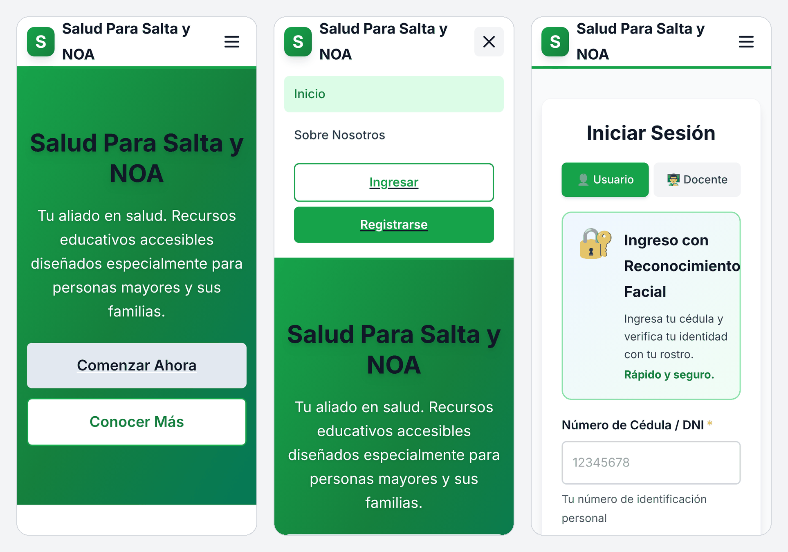

<table>
  <tr>
    <td width="55%" valign="top">
      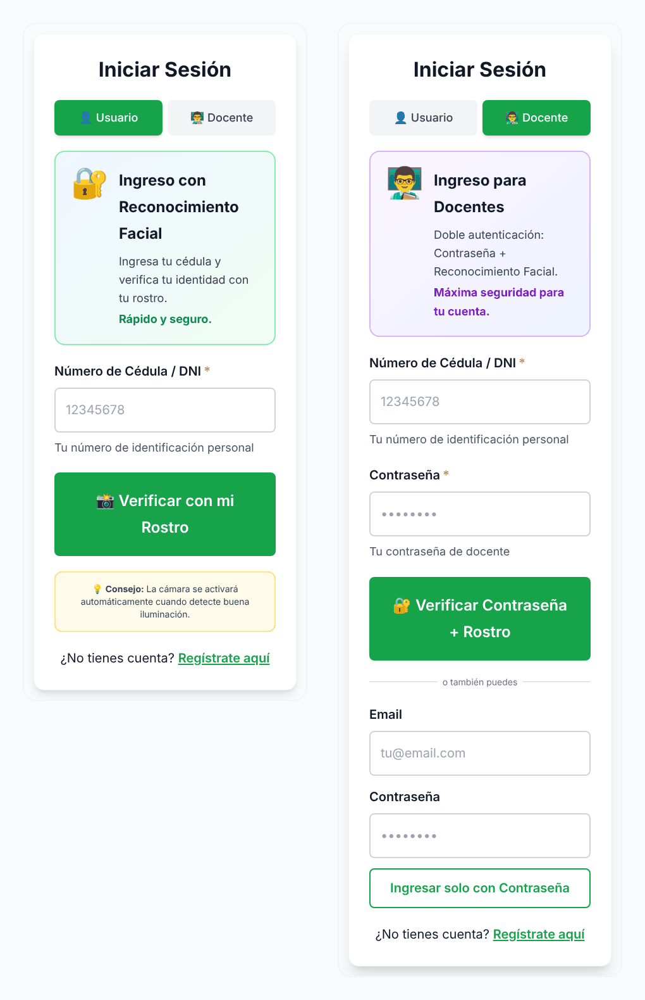
      <p><b>Ingreso:</b> el usuario entra con cédula y rostro; el docente, con contraseña y rostro, o con email y contraseña.</p>
    </td>
    <td width="45%" valign="top">
      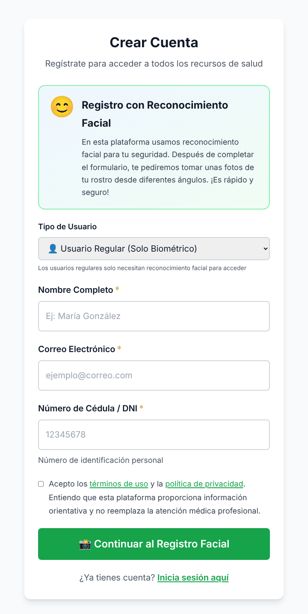
      <p><b>Registro:</b> el formulario es corto, exige consentimiento y luego pasa a la captura facial automática.</p>
    </td>
  </tr>
</table>

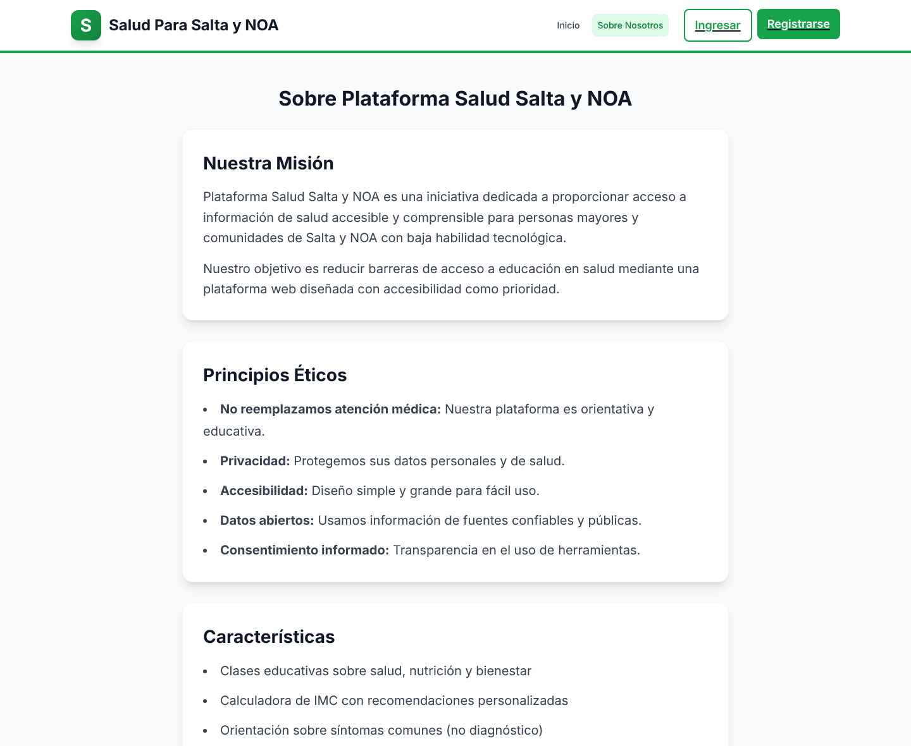
<p align="center"><i>«Sobre nosotros»: la misión y los principios éticos (no reemplazar la atención médica, privacidad, consentimiento informado).</i></p>

### Con sesión iniciada (entorno local con datos de demostración)

Las pantallas que requieren sesión se capturaron **corriendo el proyecto en local**, con las clases de ejemplo de `seedClases.ts` y una cuenta docente de prueba. Así no aparecen datos de personas reales, y además la API del sitio publicado está fuera de línea hoy (ver [Estado del proyecto](#estado-del-proyecto)). La orientación por síntomas usa el modelo real del servicio de predicción.

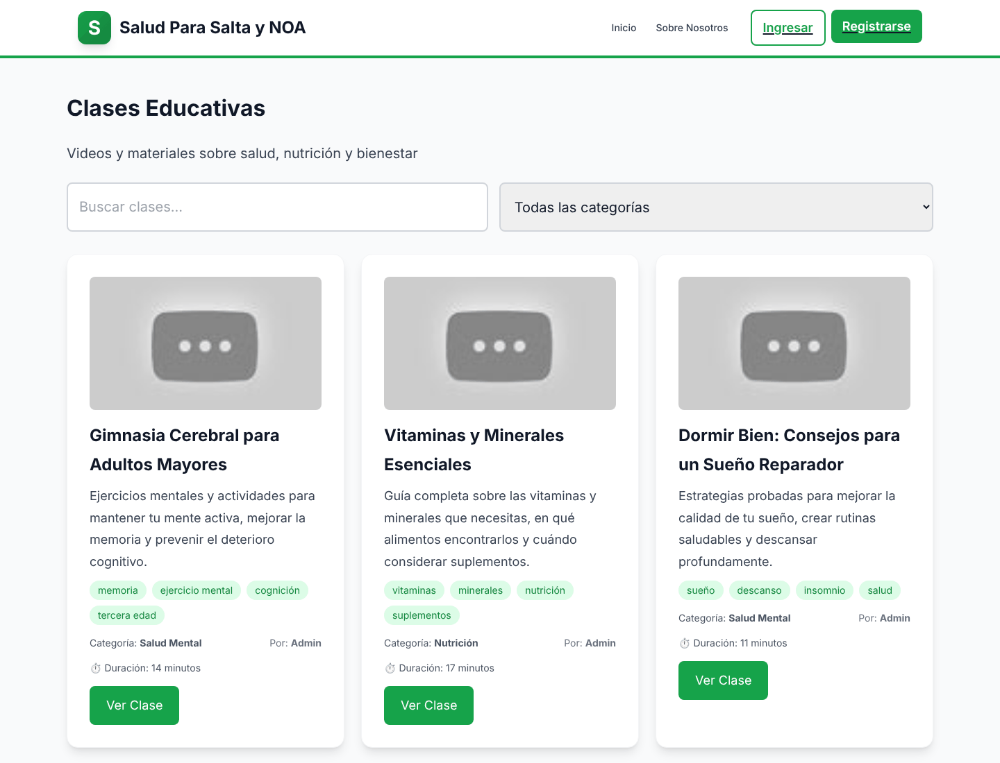
<p align="center"><i>Clases educativas con buscador y filtro por categoría. Las miniaturas grises aparecen porque los videos de ejemplo del seed ya no existen en YouTube.</i></p>

<table>
  <tr>
    <td width="51%" valign="top">
      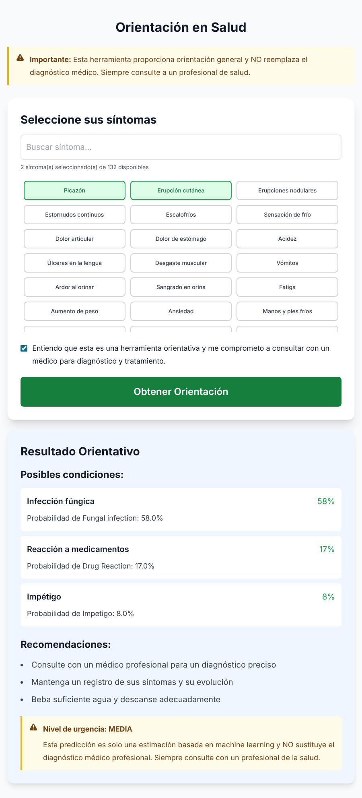
      <p><b>Orientación en salud:</b> se eligen síntomas y se acepta el consentimiento; la respuesta trae las 3 condiciones más probables, recomendaciones y el nivel de urgencia.</p>
    </td>
    <td width="49%" valign="top">
      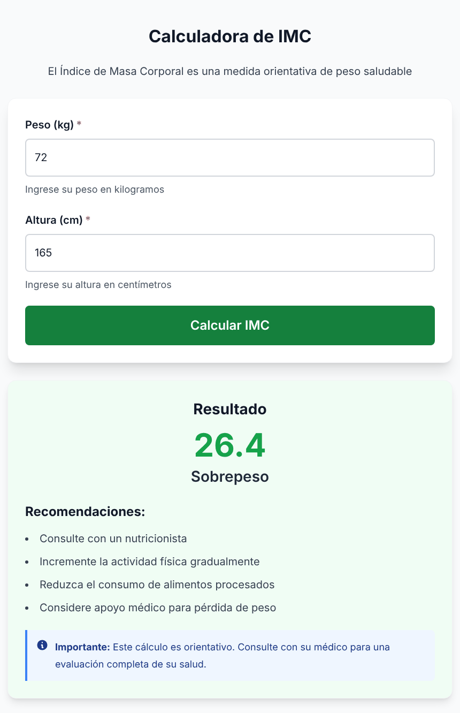
      <p><b>Calculadora de IMC:</b> muestra el resultado con su categoría y recomendaciones concretas, y queda guardado en el historial.</p>
    </td>
  </tr>
</table>

<table>
  <tr>
    <td width="50%" valign="top">
      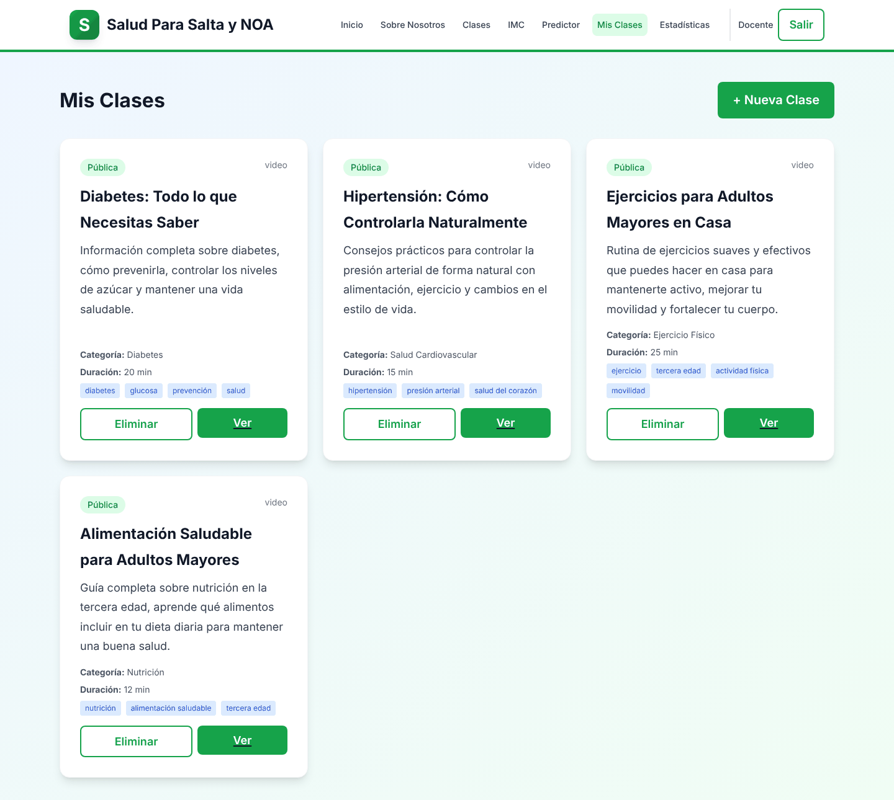
      <p><b>Panel docente, «Mis clases»:</b> crear, ver y eliminar las clases propias.</p>
    </td>
    <td width="50%" valign="top">
      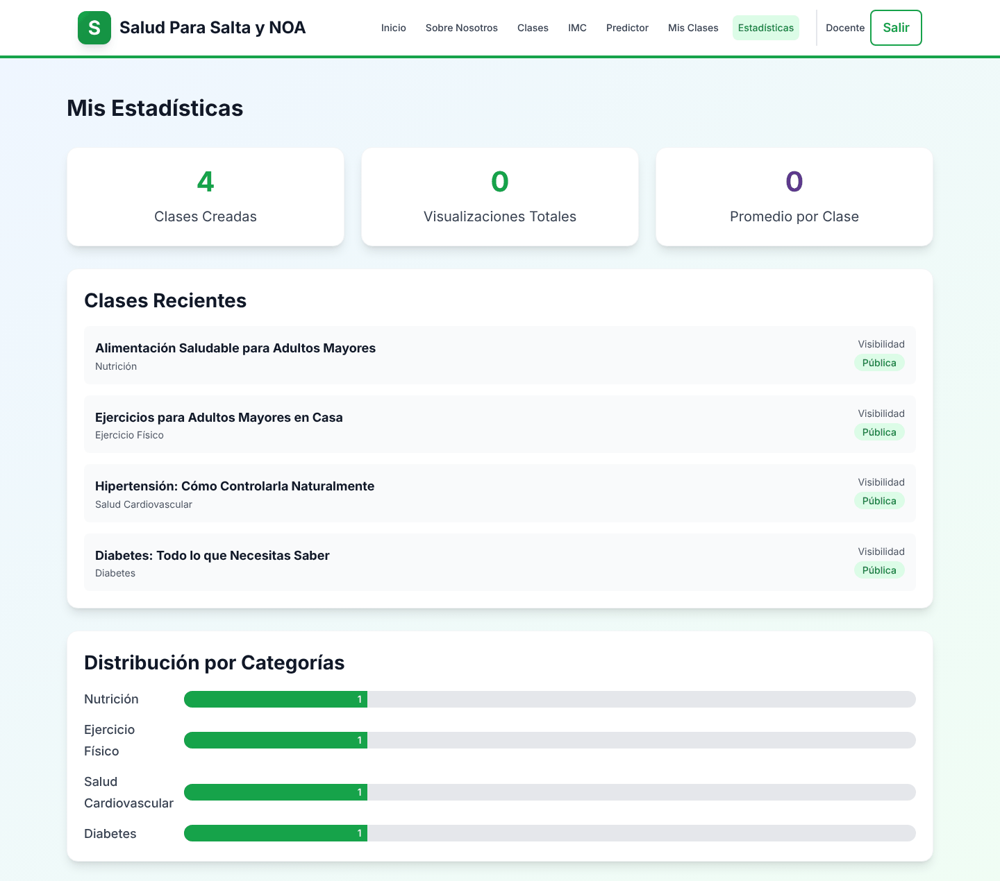
      <p><b>Panel docente, «Mis estadísticas»:</b> total de clases, clases recientes y distribución por categoría.</p>
    </td>
  </tr>
</table>

**En el celular:** clases, resultado del IMC y resultado de la orientación por síntomas.

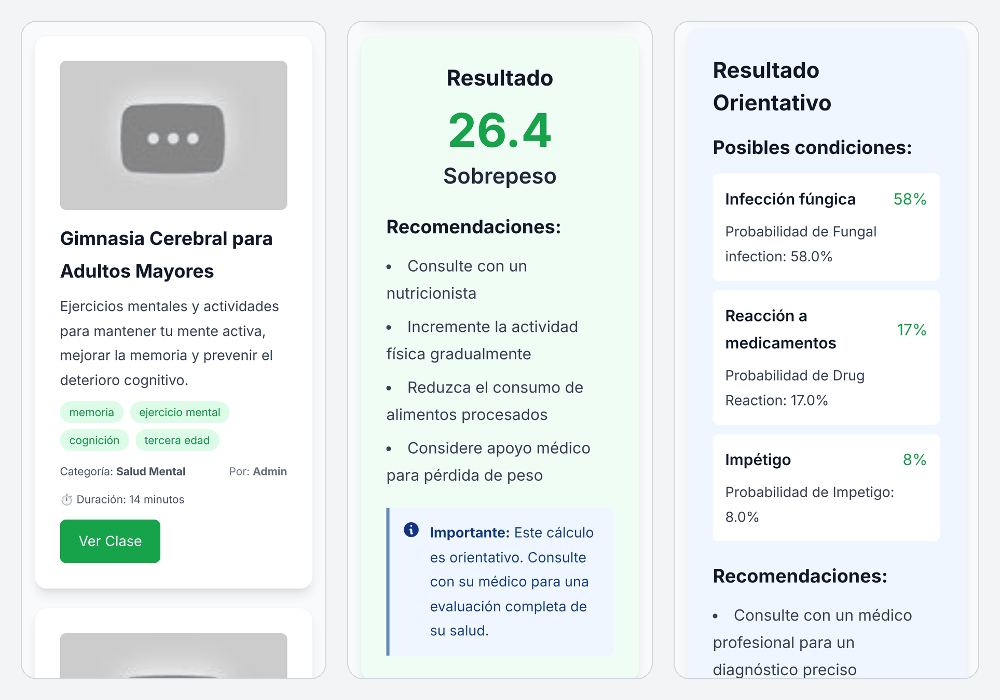

---

## Cómo funciona

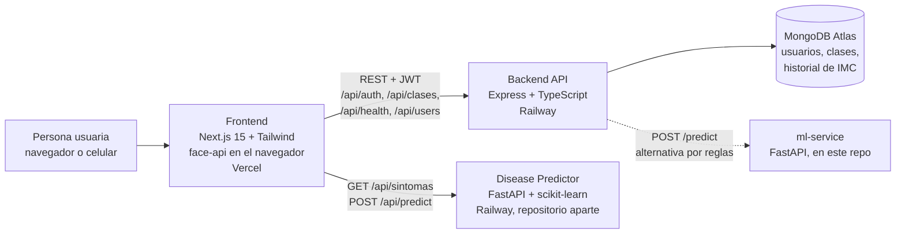

| Pieza | Carpeta | Qué hace |
|---|---|---|
| **Frontend** | [`frontend/`](frontend) | Next.js 15 (App Router). Tiene 13 páginas: portada, sobre nosotros, privacidad, términos, registro, ingreso, panel, perfil, clases, IMC, orientación y las dos del panel docente. La sesión (usuario y JWT) se guarda con Zustand en `localStorage`, y Axios agrega el token a cada pedido. |
| **Backend** | [`backend/`](backend) | API REST en Express + TypeScript con Mongoose. Se ocupa de la autenticación (contraseña, rostro y WebAuthn), los roles, las clases, el IMC y los usuarios. También expone `POST /api/health/predictor`, que consulta al `ml-service` y, si este no responde, devuelve una recomendación genérica de consultar a un médico. |
| **Disease Predictor** | [`disease-predictor`](https://github.com/ronalc90/saludsalta-disease-predictor) (repositorio aparte) | FastAPI que carga un modelo Random Forest (`modelo_enfermedades.pkl`) con 132 síntomas binarios. La página de orientación lo llama directamente con `NEXT_PUBLIC_DISEASE_PREDICTOR_URL`. |
| **ml-service** | [`ml-service/`](ml-service) | Predictor alternativo y más simple (base de conocimiento por reglas con 6 condiciones). Lo usa el endpoint `/api/health/predictor` del backend; la interfaz actual usa el Disease Predictor. |

**Ingreso con el rostro, paso a paso:**

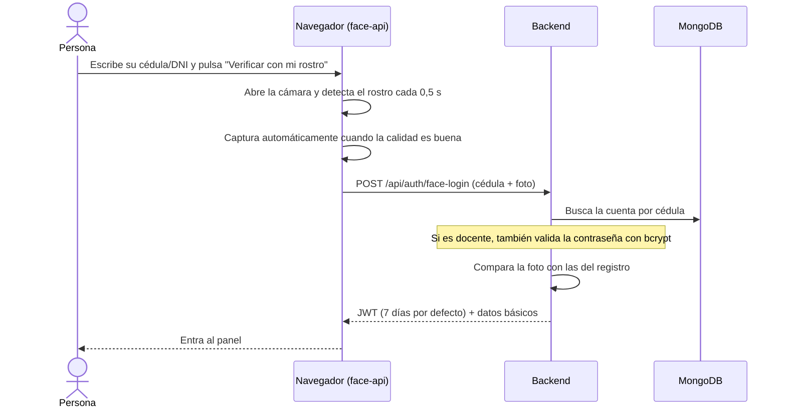

---

## Seguridad y privacidad

Esto es lo que hace el código:

- **Contraseñas con bcrypt** (10 rondas). La contraseña, las fotos faciales y los descriptores faciales están marcados `select: false` en el modelo, así que **nunca se devuelven** en las respuestas por defecto.
- **Sesiones con JWT** firmadas con `JWT_SECRET`, que vencen a los 7 días por defecto (`JWT_EXPIRES_IN`). **El servidor no arranca si falta `JWT_SECRET`** y no existe un valor por defecto.
- **Control por roles** en cada ruta sensible (`protect` + `authorize`). Un docente solo puede editar o borrar sus propias clases, y nadie puede registrarse como administrador desde el formulario público.
- **Límite de solicitudes:** 100 por IP cada 15 minutos en toda la API (configurable con `RATE_LIMIT_WINDOW_MS` y `RATE_LIMIT_MAX_REQUESTS`), y **10 intentos fallidos cada 15 minutos** en registro, ingreso con contraseña e ingreso facial.
- **Encabezados de seguridad:** el backend usa `helmet` y un **CORS con lista de orígenes permitidos** (el dominio publicado, `localhost:3000` y `FRONTEND_URL`). El frontend envía `X-Frame-Options: DENY`, `X-Content-Type-Options: nosniff` y `Referrer-Policy: strict-origin-when-cross-origin`, y oculta `X-Powered-By`.
- **Consentimiento informado obligatorio.** Para registrarse hay que aceptar los términos y la política de privacidad, y el backend rechaza el registro sin ese consentimiento. Para usar el predictor también hay que aceptarlo, y sus respuestas siempre incluyen el aviso de que no reemplazan el diagnóstico médico.
- **Secretos fuera del repositorio.** La URI de MongoDB, `JWT_SECRET` y el resto de los secretos viven **solo en las variables de entorno de Railway (backend) y Vercel (frontend)**. Los `.env` están en `.gitignore`, los `.env.example` solo contienen valores de ejemplo como `<usuario>:<contraseña>@<cluster>`, y [`railway-env-setup.sh`](backend/railway-env-setup.sh) toma los secretos de la terminal en lugar de tenerlos escritos.

> [!WARNING]
> La comparación facial y la verificación de WebAuthn en el servidor **todavía son un prototipo**. Por eso, en producción (`NODE_ENV=production`) el ingreso facial y las rutas de WebAuthn responden 503 y solo se entra con contraseña. Para probarlos en desarrollo hay que definir `ALLOW_INSECURE_BIOMETRIC_LOGIN=true`. Los detalles y el plan para resolverlo están en [Estado del proyecto](#estado-del-proyecto).

---

## Stack

| Capa | Tecnologías |
|---|---|
| Frontend | Next.js 15.5 (App Router), React 19, TypeScript, Tailwind CSS 3, Zustand, Axios, `@vladmandic/face-api`, `@simplewebauthn/browser` |
| Backend | Node.js, Express 4, TypeScript 5, Mongoose 8, jsonwebtoken, bcryptjs, helmet, cors, express-rate-limit, `@simplewebauthn/server`, Axios |
| Machine learning | Python 3.11, FastAPI, scikit-learn 1.6 (Random Forest), pandas, joblib, Uvicorn |
| Datos | MongoDB Atlas (producción) y MongoDB 7 (local) |
| Infraestructura | Vercel (frontend), Railway (backend y predictor), dominio propio `saludadultomayor.org` |

---

## Correr en local

**Requisitos:** Node.js 20 o superior (probado con 22), npm, Python 3.11 o superior y una instancia de MongoDB. El código usa `mongodb://localhost:27017/fabi_bd` si no se define `MONGODB_URI`.

### 1. Clonar e instalar

```bash
git clone https://github.com/ronalc90/saludSalta_Noa.git
cd saludSalta_Noa
npm ci          # instala frontend y backend (workspaces de npm)
```

Si no tienes MongoDB instalado, puedes levantar uno con Docker:

```bash
docker run -d --name salud-mongo -p 27017:27017 mongo:7.0
```

### 2. Backend (puerto 3001)

Crea `backend/.env` a partir de [`backend/.env.example`](backend/.env.example). Variables que lee el código:

| Variable | Obligatoria | Para qué |
|---|:---:|---|
| `JWT_SECRET` | ✅ | Firmar las sesiones. Usa una cadena larga y aleatoria, por ejemplo la salida de `openssl rand -hex 32`. |
| `MONGODB_URI` | ✅ para los scripts | Conexión a MongoDB (en Atlas: `mongodb+srv://<usuario>:<contraseña>@<cluster>/fabi_bd`). El servidor usa la base local si falta, pero `seedClases.ts` la necesita. |
| `PORT` | — | Puerto de la API (por defecto `3001`). |
| `FRONTEND_URL` | — | Origen extra permitido por CORS. |
| `JWT_EXPIRES_IN` | — | Duración de la sesión (por defecto `7d`). |
| `ML_SERVICE_URL` | — | URL del `ml-service` (por defecto `http://localhost:8001`). |
| `WEBAUTHN_RP_NAME`, `WEBAUTHN_RP_ID`, `WEBAUTHN_ORIGIN` | — | Configuración de WebAuthn (por defecto `localhost`). |
| `RATE_LIMIT_WINDOW_MS`, `RATE_LIMIT_MAX_REQUESTS` | — | Límite global de solicitudes. |

```bash
cd backend
npx tsx src/scripts/seedClases.ts  # opcional: carga las 15 clases de ejemplo
npm run dev                        # API en http://localhost:3001 (tsx en modo watch)
```

> [!CAUTION]
> `seedClases.ts` **borra las clases existentes**, y si no existe una cuenta de administrador de ejemplo, la crea con una contraseña fija escrita en el script. Úsalo solo en una base local, cambia esa contraseña y **nunca lo corras contra producción**. El script `npm run seed` está pensado para crear usuarios de demostración, pero hoy falla porque esos usuarios no tienen cédula (ver [Estado del proyecto](#estado-del-proyecto)).

Para compilar como en producción: `npm run build && npm start`.

### 3. Servicio de predicción (puerto 8000)

```bash
git clone https://github.com/ronalc90/saludsalta-disease-predictor.git
cd saludsalta-disease-predictor
python -m venv .venv && source .venv/bin/activate
pip install -r requirements.txt
uvicorn main:app --port 8000
```

<details>
<summary>Opcional: <code>ml-service</code> de este repo (puerto 8001), usado por <code>/api/health/predictor</code></summary>

```bash
cd ml-service
pip install -r requirements.txt
python -m uvicorn app.main:app --reload --port 8001
```

</details>

### 4. Frontend (puerto 3000)

Crea `frontend/.env.local` (tiene prioridad sobre el `.env.production` del repositorio) con:

| Variable | Para qué |
|---|---|
| `NEXT_PUBLIC_API_URL` | URL del backend, por ejemplo `http://localhost:3001`. |
| `NEXT_PUBLIC_DISEASE_PREDICTOR_URL` | URL del servicio de predicción, por ejemplo `http://localhost:8000`. |

```bash
cd frontend
npm run dev     # http://localhost:3000
```

Para una build de producción: `npm run build && npm start`.

---

## Despliegue

Así se despliega cada pieza, según [`DESPLIEGUE.md`](DESPLIEGUE.md), [`backend/railway.json`](backend/railway.json) y la configuración de Vercel:

| Servicio | Plataforma | Configuración |
|---|---|---|
| Frontend | **Vercel** | Proyecto Next.js con *Root Directory* `frontend`, comando `npm run build` y dominio `saludadultomayor.org`. Variables: `NEXT_PUBLIC_API_URL` y `NEXT_PUBLIC_DISEASE_PREDICTOR_URL`. |
| Backend | **Railway** | Nixpacks con `npm install && npm run build` y luego `npm start`, con reinicio automático si falla. Variables: `NODE_ENV`, `PORT`, `FRONTEND_URL`, `MONGODB_URI`, `JWT_SECRET`, `JWT_EXPIRES_IN`, `ML_SERVICE_URL`, `WEBAUTHN_*` y `RATE_LIMIT_*`. |
| Predictor | **Railway** | `Procfile` con `uvicorn main:app --host 0.0.0.0 --port $PORT` y Python 3.11. |
| Base de datos | **MongoDB Atlas** | Base `fabi_bd`. Se recomienda permitir conexiones solo desde las IPs de salida del backend y evitar `0.0.0.0/0`. |

**Regla de oro:** los valores de las variables se cargan **solo en los paneles de Railway y Vercel** (o con `railway variables set`, tomándolos de la terminal) y **nunca se escriben en el repositorio**. Si un secreto llega a publicarse alguna vez, hay que **rotarlo**: borrarlo del archivo no alcanza.

---

## Estado del proyecto

**Prototipo funcional.** La parte de clases, IMC, orientación por síntomas, roles y panel docente funciona de punta a punta. Se verificó en local el 22/10/2026: instalación, build del frontend y del backend, registro e ingreso por API, clases, IMC, predicción y panel docente.

**En producción:** el frontend está publicado en [www.saludadultomayor.org](https://www.saludadultomayor.org). Al 22/10/2026, los servicios de backend y de predicción en Railway **no responden** (Railway contesta *Application not found*). Por eso, en el sitio publicado no funcionan el ingreso, el registro, el listado de clases ni la orientación hasta que se vuelvan a desplegar.

**Pendiente y limitaciones conocidas:**

- [ ] **Verificación biométrica real en el servidor.** Hoy el navegador detecta el rostro, pero el servidor compara las fotos de forma heurística. [`faceRecognition.service.ts`](backend/src/services/faceRecognition.service.ts) ya compara descriptores faciales de 128 dimensiones (distancia euclidiana con umbral de 0,6). Falta calcular esos descriptores en el navegador con el modelo `face_recognition` (ya incluido en `frontend/public/models`) y conectar el servicio al ingreso facial.
- [ ] **WebAuthn completo.** Falta verificar la firma de la credencial en el inicio de sesión y guardar el desafío en el servidor, y luego sumar la opción «Ingresar con huella o PIN» en la interfaz.
- [ ] **Panel de administración.** El menú enlaza a `/admin`, pero esa página todavía no existe; por ahora la gestión de usuarios se hace por API.
- [ ] **Semillas de datos.** `npm run seed` falla porque los usuarios de demostración no tienen `cedula`, que es obligatoria. Además, 14 de los 15 videos de `seedClases.ts` ya no existen en YouTube, por eso sus miniaturas aparecen grises.
- [ ] **Tests automatizados.** Jest está configurado en frontend y backend, pero todavía no hay pruebas escritas.
- [ ] **`docker-compose.yml`.** La imagen del backend no compila porque el `Dockerfile` usa `npm ci` sin un lockfile propio. Por ahora conviene seguir los pasos manuales de arriba.
- [ ] **Detalles menores.** Las páginas del panel docente redirigen al ingreso si se abren pegando la URL (desde el menú funcionan bien). El contador de visualizaciones de las clases siempre muestra 0. El nivel de urgencia del predictor depende de la confianza del modelo, no de la gravedad clínica. Y el modelo no está validado clínicamente.

---

## Autor

**Ronald Cipagauta** · [koptup.com](https://www.koptup.com) · [github.com/ronalc90](https://github.com/ronalc90)

---

## Licencia

Distribuido bajo la licencia **MIT**. Ver [`LICENSE`](LICENSE).
